# Лабараторная работа №4
# Файлы: TXT/CSV и отчёты по текстовой статистике

## Задание A
## Были реализованы две функции, которые использовались в задании B

### 1ая функция - read_text
Функционал - считывание содержимого файла целиком в одну строку. Но в реальных задачах желательно считывать построчно.
Если файл пустой, то выводится пустая строка.

```python
def read_text(path: str | Path, encoding: str = "utf-8") -> str:
    '''
    Чтение файла через path c кодировкой  "utf-8" по умолчанию
    и преобразование его в одну строку.

    Если файл не найден - FileNotFoundError.
    Если неподходящая кодировка - UnicodeDecodeError.

    Для замены кодировки во время вызова функции нужно передать в параметр encoding другую кодировку.
    Пример: read_text(data.txt, encoding="cp1251")
    '''
    p = Path(path)
    return ' '.join(p.read_text(encoding=encoding).split())
```

### 2ая функция - write_csv
Функционал - создание/перезаписть CSV с разделителем ",".
Если rows - пустой массив и header - None, то создаться пустой файл. Если header не None, а rows - пустой массив, то в результате файл только с заголовком.

```python
def write_csv(rows: Iterable[Sequence], path: str | Path, 
              header: tuple[str, ...] | None = None) -> None:
    '''
    Создание/перезапись CSV с разделителем "," строк с одинаковой длиной 
    (в противном случае - ValueError).
    Если передан header - запись первой строкой в качестве заголовка.
    '''
    p = Path(path)
    rows = list(rows)

    if rows:
        if len(set(len(r) for r in rows)) != 1: 
            raise ValueError('Строки не одинаковой длины')
        if header is not None and list(set(len(r) for r in rows))[0] != len(header):
            raise ValueError('Строки и заголовок не совпадают по длине')

    ensure_parent_dir(path)
    with p.open("w", newline="", encoding="utf-8") as f:
        w = csv.writer(f)
        if header is not None:
            w.writerow(header)
        for r in rows:
            w.writerow(r)
```

### 3ья функция (★) - ensure_parent_dir
Функционал - создание родительской директории при отсутствии

```python
def ensure_parent_dir(path: str | Path) -> None:
    '''
    Создание родительской директории, если такие отсутсвуют
    '''
    p = Path(path)
    p.parent.mkdir(parents=True, exist_ok=True)
```

### Мини-тест:
```python
txt = read_text("data/input.txt")
print(txt)
write_csv([("word","count"),("test",3)], "data/check.csv")
```

### Терминал:
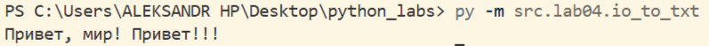
### data/check.csv с написанным CSV:
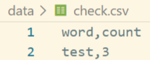

## Задание B
## Был реализован скрипт text_report для создания общего отчёта по файлу(ам), состоящим из пар "слово - частота", и в дополнение отчёт в формате "файл - слово - частота" для нескольких файлов. Если файл не существует - FileNotFoundError; если файл пуст - отчёт содержит только заголовок "word,count".

### Функции, которые были написаны для реализации скрипта:
#### Общий отчёт:
```python
def report_total(files: str, res_file: str, encoding: str='utf-8'):
    '''
    Создание отчёта по файлу(ам) в формате:
    слово - количество упоминаний.
    '''
    all_words = []
    for f in files:
        text = read_text(f, encoding=encoding)
        words = tokenize(normalize(text))
        all_words.extend(words)
    lines = Counter(all_words).items()
    write_csv(lines, res_file, header=('word', 'count'))
```

### Функция пофайлового отчёта:
```python
def report_per_file(files: list[str], res_file: str, encoding: str='utf-8') -> None:
    '''
    Создание отчёта данных по каждому файлу в формате:
    файл - слово - количество упоминаний.
    '''
    lines = []
    for f in files:
        text = read_text(f, encoding=encoding)
        sorted_freq = sorted_word_counts(frequencies_from_text(text))
        file_name = Path(f).name
        for w_c in sorted_freq:
            lines.append([file_name]+list(w_c))
    lines.sort(key=lambda x: (x[0], -x[2], x[1]))
    write_csv(lines, res_file, header=('file', 'word', 'count'))
```

### Алгоритм работы:
1. py -m src.lab04.text_report + параметры
2. --in → входной(ые) файл(ы)
3. --out → файл в котором формируется отчёт, если нужно обработать один файл (по умолчанию - data/report.csv)
4. --encoding → кодировка (по умолчанию UTF-8)
5. --per-file и --total → файлы для отчётов по каждому файлу и общему соответсвенно для нескольких файлов

### Тест-кейсы:
#### A. Один файл
#### data/input.txt: "Привет, мир! Привет!!!"
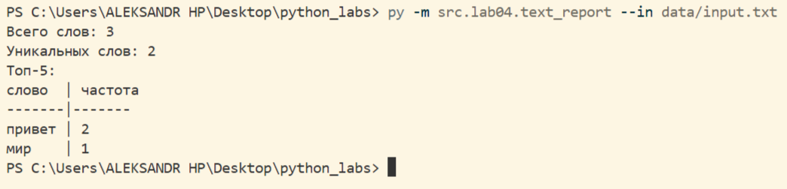

#### отчёт data/report.csv:
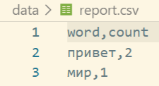

#### B. Пустой файл
#### data/input.txt: пустой файл
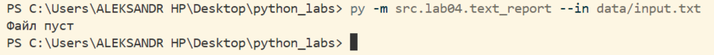

#### отчёт data/report.csv:
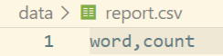

#### C. Кодировка cp1251
#### data/input.txt: "Привет" в кодировке cp1251
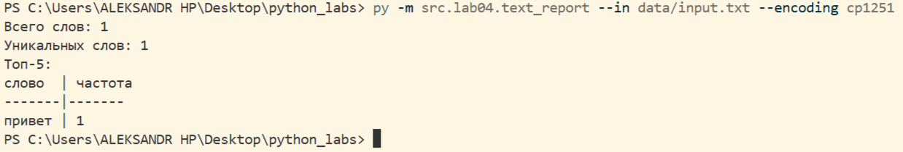

#### отчёт data/report.csv:
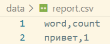

#### D★. Несколько файлов
#### data/a.txt: "Привет мир", data/b.txt: "Привет, привет!"
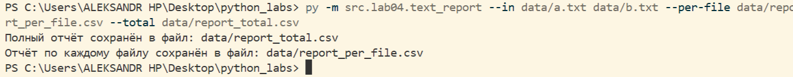

#### отчёт data/report_total.csv и data/report_per_file.csv:
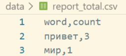
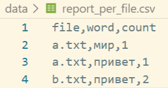
