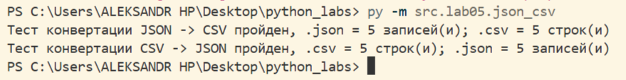
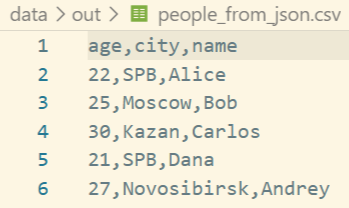
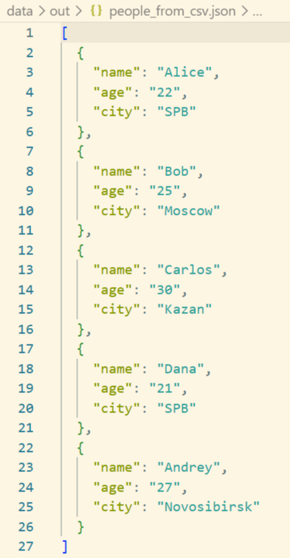
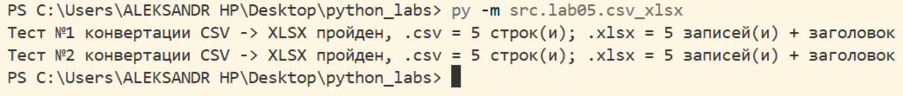
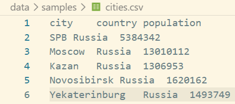
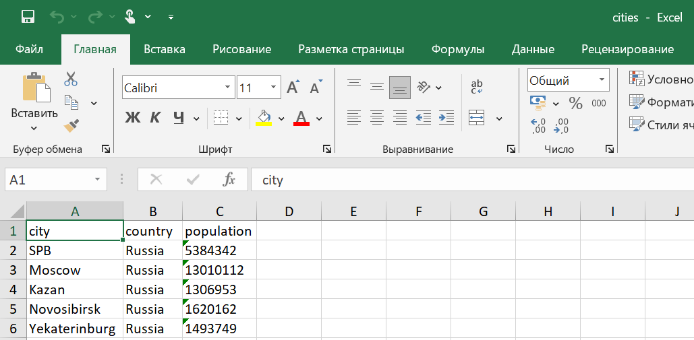

# Лабараторная работа №5
# JSON и конвертации (JSON↔CSV, CSV→XLSX)

## Задание A
## Были реализованы две функции, для перевода файлов из .json в .csv и наоборот

### 1ая функция - json_to_csv
Функционал - считывание содержимого .json файла и перевод его в формат .csv

```python
import json
from pathlib import Path
import csv
from src.lab04.io_to_txt import ensure_parent_dir

def json_to_csv(json_path: str, csv_path: str) -> None:
    '''
    Преобразует JSON-файл в CSV.
    Поддерживает список словарей [{...}, {...}], заполняет отсутствующие поля пустыми строками.
    Кодировка UTF-8.
    '''
    try:
        with open(json_path, 'r', encoding='utf-8') as f:
            json_file = json.load(f)
        if not(type(json_file) == list): raise ValueError('Функция не поддерживает формат данных отличный от списка.')
        if not(all([type(d) == dict for d in json_file])): raise ValueError('Список должен содержать только словари.')
        if len(json_file) == 0: raise ValueError('Входной файл пуст')
        if Path(csv_path).suffix != '.csv': raise ValueError('Невозможно перевести данные в отличный от .csv файл')

        fieldnames = set()
        for dict_r in json_file:
            fieldnames.update(dict_r.keys())
        fieldnames = sorted(list(fieldnames))
        ensure_parent_dir(csv_path)
        with open(csv_path, 'w', newline='', encoding='utf-8') as f:
            csv_file = csv.DictWriter(f, fieldnames=fieldnames, extrasaction='ignore')
            csv_file.writeheader()
            csv_file.writerows(json_file)
    except FileNotFoundError:
        raise FileNotFoundError('Файл не найден.')
    except UnicodeDecodeError:
        raise ValueError('Кодировка не соответствует "utf-8".')
    except json.JSONDecodeError:
        raise ValueError('Невозможно обработать не .json файл')
```

## 2ая функция - csv_to_json
Функционал - считывание содержимого .csv файла и перевод его в формат .json

```python
import json
from pathlib import Path
import csv
from src.lab04.io_to_txt import ensure_parent_dir

def csv_to_json(csv_path: str, json_path: str) -> None:
    '''
    Преобразует CSV в JSON (список словарей) c заголовком.
    '''
    try:
        with open(csv_path, newline='', encoding='utf-8') as f:
            sample = f.read(2048)
            sniffer = csv.Sniffer()
            dialect = sniffer.sniff(sample)
            f.seek(0)
            csv_file = list(csv.DictReader(f, dialect=dialect))
        if not sniffer.has_header(sample): raise ValueError('В файле отсутсвует заголовок')
        if len(csv_file) == 0: raise ValueError('Входной файл пуст')
        if Path(json_path).suffix != '.json': raise ValueError('Невозможно перевести данные в отличный от .json файл')
    
        ensure_parent_dir(json_path)
        with open(json_path, 'w', encoding='utf-8') as f:
            json.dump(csv_file, f, ensure_ascii=False, indent=2)
    except FileNotFoundError:
        raise FileNotFoundError('Файл не найден.')
    except UnicodeDecodeError:
        raise ValueError('Кодировка не соответствует "utf-8".')
    except csv.Error:
        raise ValueError('Невозможно обработать не .csv файл.')
```

### Тест-кейсы для задания А

Запуск: py -m src.lab05.json_csv

```python
if __name__ == '__main__':
    json_to_csv('data/samples/people.json', 'data/out/people_from_json.csv')
    csv_to_json('data/samples/people.csv', 'data/out/people_from_csv.json')

    with open('data/samples/people.json', 'r', encoding='utf-8') as f:
        len_json_file = len(json.load(f))
    with open('data/out/people_from_json.csv', newline='', encoding='utf-8') as f:
        len_csv_res = len(list(csv.DictReader(f)))

    with open('data/samples/people.csv', newline='', encoding='utf-8') as f:
        len_csv_file = len(list(csv.DictReader(f)))
    with open('data/out/people_from_csv.json', 'r', encoding='utf-8') as f:
        len_json_res = len(json.load(f))

    assert len_json_file == len_csv_res
    print(f'Тест конвертации JSON -> CSV пройден, .json = {len_json_file} записей(и); .csv = {len_csv_res} строк(и)')
    assert len_csv_file == len_json_res
    print(f'Тест конвертации CSV -> JSON пройден, .csv = {len_csv_file} строк(и); .json = {len_json_res} записей(и)')
```

### Результат:
### Терминал:


### .json → .csv:



### .csv → .json:




## Задание B
## Была реализована одна функция, для перевода файлов из .csv в .xlsx

## Функция - csv_xlsx
Функционал - считывание содержимого .csv файла и перевод его в формат .xlsx

```python
import openpyxl
import csv
from pathlib import Path
from src.lab04.io_to_txt import ensure_parent_dir

def csv_to_xlsx(csv_path: str, xlsx_path: str) -> None:
    '''
    Конвертация CSV в XLSX.
    Первая строка CSV — заголовок.
    Колонки — автоширина по длине текста (не менее 8 символов).
    '''
    wb = openpyxl.Workbook()
    ws = wb.active
    ws.title = 'Sheet1'
    try:
        with open(csv_path, encoding='utf-8') as f:
            sample = f.read()
            sniffer = csv.Sniffer()
            dialect = sniffer.sniff(sample)
            f.seek(0)
            csv_file = list(csv.reader(f, dialect=dialect))
        if Path(xlsx_path).suffix != '.xlsx': raise ValueError('Невозможно перевести данные в отличный от .xlsx файл')
        if len(csv_file) < 2: raise ValueError('Файл пуст, или в файле отсутствует заголовок, или в файле присутствует только ')
        for line in csv_file:
            ws.append(line)
        for column in ws.columns:
            len_column = max([len(str(cell.value)) for cell in column] + [8])
            ws.column_dimensions[column[0].column_letter].width = len_column
        ensure_parent_dir(xlsx_path)
        wb.save(xlsx_path)

    except FileNotFoundError:
        raise FileNotFoundError('Файл не найден.')
    except UnicodeDecodeError:
        raise ValueError('Кодировка не соответствует "utf-8".')
    except csv.Error:
        raise ValueError('Невозможно обработать не .csv файл.')
```

### Тест-кейсы для задания А

Запуск: py -m src.lab05.csv_xlsx

```python
if __name__ == '__main__':
    csv_to_xlsx('data/samples/cities.csv', 'data/out/cities.xlsx')
    csv_to_xlsx('data/samples/people.csv', 'data/out/people.xlsx')

    with open('data/samples/cities.csv', newline='', encoding='utf-8') as f:
        len_csv_file = len(list(csv.DictReader(f)))
    
    cities_xlsx_out = openpyxl.load_workbook('data/out/cities.xlsx')
    sheet1 = cities_xlsx_out["Sheet1"]
    len_xlsx_cities = sheet1.max_row - 1 # -заголовок
    assert len_csv_file == len_xlsx_cities
    print(f'Тест №1 конвертации CSV -> XLSX пройден, .csv = {len_csv_file} строк(и); .xlsx = {len_xlsx_cities} записей(и) + заголовок')

    with open('data/samples/people.csv', newline='', encoding='utf-8') as f:
        len_csv_file = len(list(csv.DictReader(f)))
    people_xlsx_out = openpyxl.load_workbook('data/out/cities.xlsx')
    sheet2 = people_xlsx_out["Sheet1"]
    len_xlsx_people = sheet2.max_row - 1 # -заголовок
    assert len_csv_file == len_xlsx_people
    print(f'Тест №2 конвертации CSV -> XLSX пройден, .csv = {len_csv_file} строк(и); .xlsx = {len_xlsx_people} записей(и) + заголовок')
```

### Результат:
### Терминал:


### people.csv → people.xlsx:


### cities.csv → cities.xlsx:




#### Правила обработки файлов:
1. Неверный тип файла - ValueError с указанием нужного типа
2. Файл отсутсвует - FileNotFoundError
3. Кодировка - только UTF-8
4. Алфавитный порядок расположения колонок при использовании "json_to_csv"
5. Автоширина колонок при использовании csv_to_xlsx (минимум - 8)
6. Заголовок и 1 строка обязательны при использовании csv_to_xlsx