# Лабараторная работа №6
# CLI‑утилиты с argparse (cat/grep‑lite + конвертеры)

## Были реализованы два модуля

### Запуск:
#### cli.text
```python
py -m src.lab06.cli_text [подкоманда] [аргументы]
```

#### cli.convert
```python
py -m src.lab06.cli_convert [подкоманда] [--in файл] [--out файл]
```

## 1ый - cli_text
Функционал: 
1. При вызове подкоманды "cat" - входной файл выводится построчно, опционально с нумерацией строк при помощи аргумента "-n".
2. При вызове подкоманды "stats" - вывод статистики по словам и их частоте, присутствует возможность изменения количества выводимых слов в топе по частоте при помощи аргумента "--top k", где k - количество выводимых слов в топе по частоте.

```python
import argparse
from src.lab04.io_to_txt import read_text
from src.lib.text import normalize, tokenize, count_freq, top_n

def main():
    '''
    Скрипт для вывода содержимого файла по строкам (опционально - нумерованно),
    или для вывода частот слов во входном файле.
    '''
    parser = argparse.ArgumentParser(description="CLI‑утилиты лабораторной №6")
    subparsers = parser.add_subparsers(dest="command")

    cat_parser = subparsers.add_parser("cat", help="Вывести содержимое файла")
    cat_parser.add_argument("--input", required=True, help='Входной файл')
    cat_parser.add_argument("-n", action="store_true", help="Требуется ли нумерация строк")

    stats_parser = subparsers.add_parser("stats", help="Частоты слов")
    stats_parser.add_argument("--input", required=True, help='Входной файл в формате .txt')
    stats_parser.add_argument("--top", type=int, default=5, \
                              help='Количество значений при выводе таблицы с частотами (по умолчанию - 5)')

    args = parser.parse_args()

    if args.command == "cat":
        lines = read_text(args.input).splitlines()
        if args.n:
            for i in range(1, len(lines) + 1):
                print(f'{i}. {lines[i - 1]}')
        else:
            for l in lines:
                print(l)
    elif args.command == "stats":
        full_text = read_text(args.input)
        normalized_text = normalize(full_text)
        words = tokenize(normalized_text)
        unique_words = count_freq(words)
        print(f'Всего слов: {len(words)}')
        print(f'Уникальных слов: {len(unique_words)}')
        
        top_words = top_n(unique_words, n=args.top)
        max_len_word = max(len(w[0]) for w in top_words)
        len_table = max(len('слово'), max_len_word)
        print(f'{'слово':<{len_table}} | частота')
        print(f'{'-' * len_table}-|-------')
        for w, n in top_words:
            print(f'{w:<{len_table}} | {n}')

if __name__ == '__main__':
    main()
```

### Примеры работы:
### cat:
### Терминал
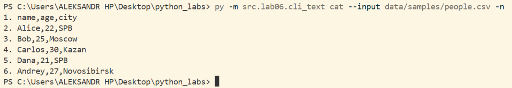

### Входные данные
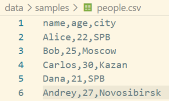

### stats:
### Терминал
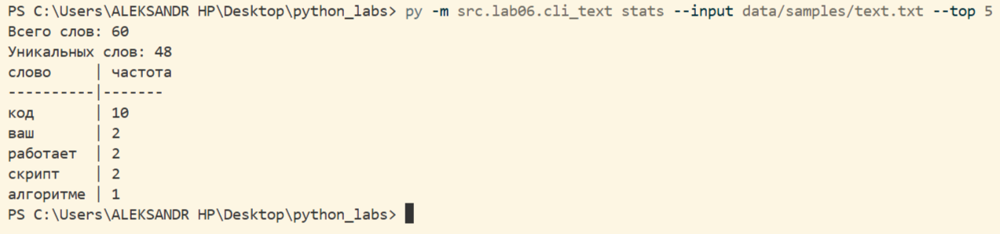

### Входные данные
```python
Код — это просто инструмент. 
Хороший код пишется человеком, но эффективный код всегда проверяется машиной. 
Когда программист пишет код, он думает о логике. 
Если код работает медленно, значит, в алгоритме есть ошибка. 
Чистый код легко читать. Сложный код трудно поддерживать. 
Изучайте код, пишите код каждый день, и ваш код станет совершенным. 
Работает ли ваш скрипт? Этот скрипт должен точно посчитать всё!
```


### --help
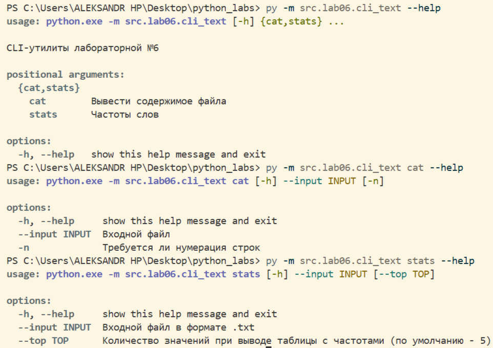


## 2ой - cli_convert
Функционал: 
1. При вызове подкоманды "json2csv" - входные данные файла из формата .json переводятся и записываются в .csv файл
2. При вызове подкоманды "csv2json" - входные данные файла из формата .csv переводятся и записываются в .json файл
3. При вызове подкоманды "csv2xlsx" - входные данные файла из формата .csv переводятся и записываются в .xlsx файл

```python
import argparse
from src.lab05.json_csv import json_to_csv, csv_to_json
from src.lab05.csv_xlsx import csv_to_xlsx

def main():
    '''
    Скрипт для перевода файлов в из .json в .сsv и наоборот, а также из .csv в .xlsx формат.
    '''
    parser = argparse.ArgumentParser(description="Конвертеры данных")
    sub = parser.add_subparsers(dest="command")

    p1 = sub.add_parser("json2csv", help='Перевод данных из .json файла в .csv файл')
    p1.add_argument("--in", dest="input", required=True, help='Входной файл в формате .json')
    p1.add_argument("--out", dest="output", required=True, help='Файл для результата в формате .csv')

    p2 = sub.add_parser("csv2json", help='Перевод данных из .csv файла в .json файл')
    p2.add_argument("--in", dest="input", required=True, help='Входной файл в формате .csv')
    p2.add_argument("--out", dest="output", required=True, help='Файл для результата в формате .json')

    p3 = sub.add_parser("csv2xlsx", help='Перевод данных из .csv файла в .xlsx файл')
    p3.add_argument("--in", dest="input", required=True, help='Входной файл в формате .csv')
    p3.add_argument("--out", dest="output", required=True, help='Файл для результата в формате .xlsx')

    args = parser.parse_args()

    if args.command == 'json2csv':
        json_to_csv(args.input, args.output)
    elif args.command == 'csv2json':
        csv_to_json(args.input, args.output)
    elif args.command == 'csv2xlsx':
        csv_to_xlsx(args.input, args.output)
    print(f'Данные из файла {args.input} преобразованы и помещены в файл {args.output}!')
if __name__ == '__main__':
    main()
```

### Примеры работы:
### json2csv:
### Терминал
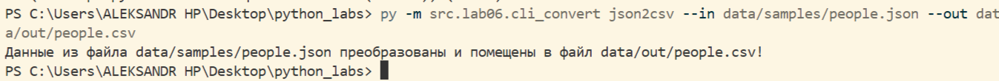

### Входные данные
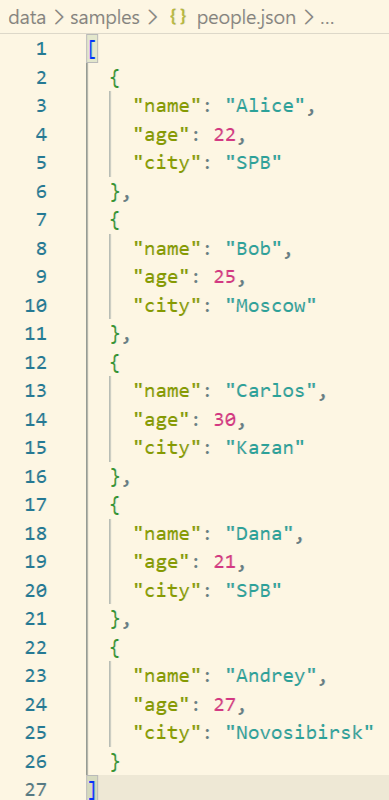

### Выходные данные
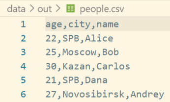

### csv2json:
### Терминал
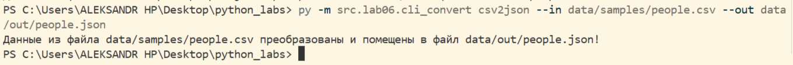

### Входные данные


### Выходные данные
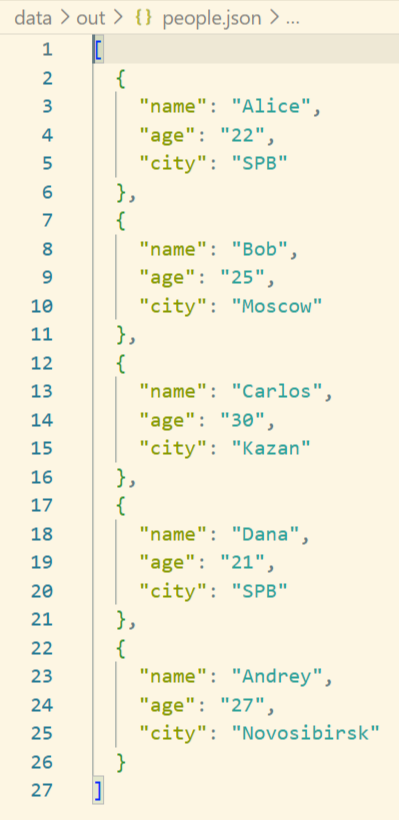

### csv2xlsx:
### Терминал
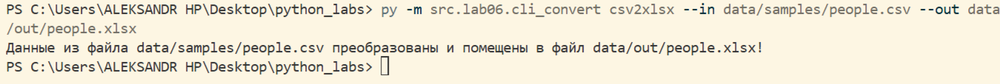

### Входные данные


### Выходные данные
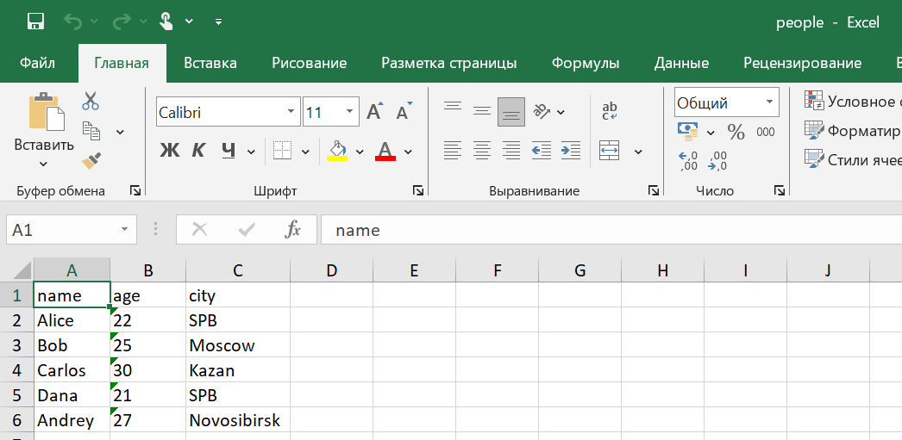

### --help
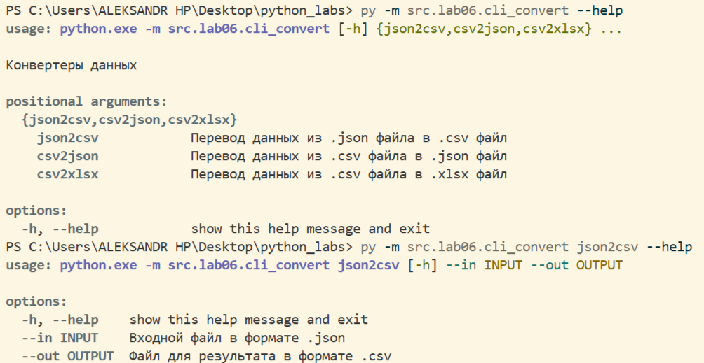
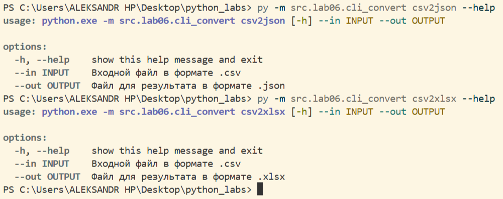