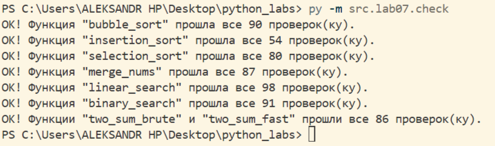
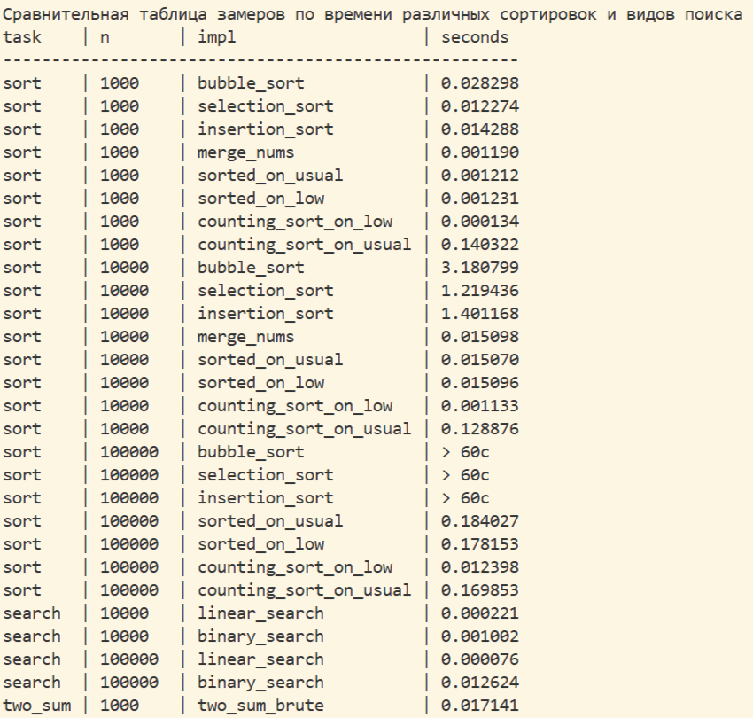
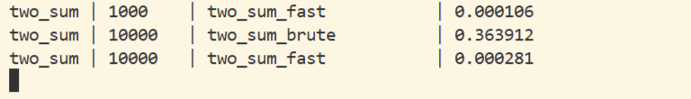
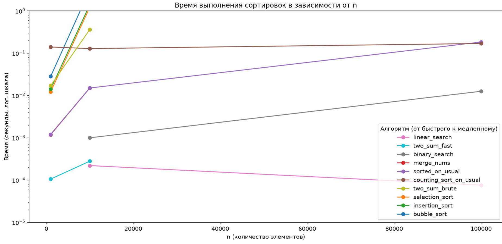

# Лабораторная работа №7
# Поиск, сортировка и измерение времени

## Были реализованы два блока с функциями, модуль с их проверками и модуль для сравнения функций по времени в зависимости от объёма данных.

## 1ый блок (сортировки):
- bubble_sort - сортировка пузырьком
```python
def bubble_sort(nums) -> list:
    '''
    Сортировка "пузырьком" списка без изменения исходного.
    '''
    sorted_nums = list(nums)
    for i in range(len(sorted_nums)):
        swapped = False
        for j in range(len(sorted_nums) - i - 1):
            if sorted_nums[j] > sorted_nums[j + 1]:
                sorted_nums[j], sorted_nums[j + 1] = sorted_nums[j + 1], sorted_nums[j]
                swapped = True
        if not swapped:
            break
    return sorted_nums
```
- insertion_sort - сортировка вставками
```python
def insertion_sort(nums) -> list:
    '''
    Сортировка вставками списка без изменения исходного.
    '''
    sorted_nums = list(nums)
    for i in range(1, len(sorted_nums)):
        v = sorted_nums[i]
        j = i - 1
        while j >= 0 and sorted_nums[j] > v:
            sorted_nums[j + 1] = sorted_nums[j]
            j -= 1
        sorted_nums[j + 1] = v
    return sorted_nums
```
- selection_sort - сортировка выбором
```python
def selection_sort(nums) -> list:
    '''
    Сортировка выбором списка без изменения исходного.
    '''
    sorted_nums = list(nums)
    for i in range(len(sorted_nums) - 1):
        i1 = i
        for j in range(i + 1, len(sorted_nums)):
            if sorted_nums[j] < sorted_nums[i1]:
                i1 = j
        sorted_nums[i], sorted_nums[i1] = sorted_nums[i1], sorted_nums[i]
    return sorted_nums
```
- (★) merge_nums - сортировка отрезками
```python
def merge_nums(nums: list) -> list:
    '''
    Сортировка отрезками списка без изменения исходного.
    '''
    sorted_nums = list(nums)
    length = 1
    while length < len(sorted_nums):
        for i in range(0, len(sorted_nums), 2 * length):
            left, right = sorted_nums[i: i + length], sorted_nums[i + length:i + 2 * length]
            merge = []
            l_seg, r_seg = 0, 0
            while l_seg < len(left) and r_seg < len(right):
                if left[l_seg] <= right[r_seg]:
                    merge.append(left[l_seg])
                    l_seg += 1
                else:
                    merge.append(right[r_seg])
                    r_seg += 1

            merge.extend(left[l_seg:])
            merge.extend(right[r_seg:])
            sorted_nums[i: i + len(merge)] = merge
        length *= 2
    return sorted_nums
```
- (★) counting_sort - сортировка ля целых чисел в диапозоне от lo до hi
```python
def counting_sort(nums: list, lo: int, hi: int) -> list:
    '''
    Сортировка подсчётом для целых чисел в диапозоне от lo до hi
    без изменения исходного списка.
    '''
    nums_copy = list(nums)
    counter = [0] * (hi - lo + 1)
    for x in nums_copy:
        counter[x - lo] += 1
    for i in range(1, hi - lo + 1):
        counter[i] += counter[i - 1]
    sorted_nums = [0] * len(nums_copy)
    for y in reversed(nums_copy):
        counter[y - lo] -= 1
        sorted_nums [counter[y - lo]] = y
    return sorted_nums
```

## 2ой блок - поиск индексов:
- linear_search - линейный поиск индекса
```python
def linear_search(nums, x) -> int:
    '''
    Поиск индекса первого вхождения, при отсутствии - "-1".
    Линейный поиск.
    '''
    for i, v in enumerate(nums):
        if v == x: return i
    return -1
```
- binary_search - бинарный поиск индекса в отсортированном по возрастанию списке
```python
def binary_search(sorted_nums, x) -> int:
    '''
    Поиск индекса первого вхождения, при отсутствии - "-1".
    Подаваемый список должен быть отсортирован по возрастанию.
    На неотсортированном списке результат не определён.
    Бинарный поиск.
    '''
    lo, hi = 0, len(sorted_nums) - 1
    while lo <= hi:
        mid = (hi + lo) // 2
        if sorted_nums[mid] == x: return mid
        elif sorted_nums[mid] < x: lo = mid + 1
        else: hi = mid - 1
    return -1
```
- two_sum_brute - поиск двух индексов элементов, чтобы их сумма равнялась заданному target
```python
def two_sum_brute(nums, target) -> tuple[int, int] | None:
    '''
    Поиск пары индексов (i, j), i < j, таких что
    nums[i] + nums[j] == target, при отсутствии - None.
    Двойной цикл.
    '''
    for i in range(len(nums) - 1):
        for j in range(i + 1, len(nums)):
            if nums[i] + nums[j] == target: return i, j
    return None
```
- two_sum_fast - ускоренная версия two_sum_brute, через словарь
```python
def two_sum_fast(nums, target) -> tuple[int, int] | None:
    '''
    Поиск пары индексов (i, j), i < j, таких что
    nums[i] + nums[j] == target, при отсутствии - None.
    Цикл через словарь.
    '''
    seen = dict()
    for i, x in enumerate(nums):
        t_x = target - x
        if t_x in seen:
            return seen[t_x], i
        seen[x] = i
    return None
```

## 1ый модуль - проверка написанных функций:
```python
if __name__ == "__main__":
    random.seed(42)
  
    for fn in (bubble_sort, insertion_sort, selection_sort, merge_nums):
        n_sorting = random.randint(50, 100)
        check_sorting(fn, n_sorting)
        print(f'ОК! Функция "{fn.__name__}" прошла все {n_sorting} проверок(ку).')

    for fn in (linear_search, binary_search):
        n_search = random.randint(50, 100)
        check_search(fn, n_search)
        print(f'ОК! Функция "{fn.__name__}" прошла все {n_search} проверок(ку).')

    n_twosum = random.randint(50, 100)
    check_two_sum(n_twosum)
    print(f'ОК! Функции "two_sum_brute" и "two_sum_fast" прошли все {n_twosum} проверок(ку).')
```

### Запуск:
```python
py -m src.lab07.check
```

### Результат проверки всех функций:



## 2ой модуль - сравнение разных сортировок и поисков по времени в зависимости от размера данных:

### Запуск:
```python
py -m src.lab07.bench
```

### Терминал:



### bench.csv:
```python
task,n,impl,seconds
sort,1000,bubble_sort,0.028298
sort,1000,selection_sort,0.012274
sort,1000,insertion_sort,0.014288
sort,1000,merge_nums,0.001190
sort,1000,sorted_on_usual,0.001212
sort,1000,sorted_on_low,0.001231
sort,1000,counting_sort_on_low,0.000134
sort,1000,counting_sort_on_usual,0.140322
sort,10000,bubble_sort,3.180799
sort,10000,selection_sort,1.219436
sort,10000,insertion_sort,1.401168
sort,10000,merge_nums,0.015098
sort,10000,sorted_on_usual,0.015070
sort,10000,sorted_on_low,0.015096
sort,10000,counting_sort_on_low,0.001133
sort,10000,counting_sort_on_usual,0.128876
sort,100000,bubble_sort,> 60c
sort,100000,selection_sort,> 60c
sort,100000,insertion_sort,> 60c
sort,100000,sorted_on_usual,0.184027
sort,100000,sorted_on_low,0.178153
sort,100000,counting_sort_on_low,0.012398
sort,100000,counting_sort_on_usual,0.169853
search,10000,linear_search,0.000221
search,10000,binary_search,0.001002
search,100000,linear_search,0.000076
search,100000,binary_search,0.012624
two_sum,1000,two_sum_brute,0.017141
two_sum,1000,two_sum_fast,0.000106
two_sum,10000,two_sum_brute,0.363912
two_sum,10000,two_sum_fast,0.000281
```

### График (★):


## Выводы:
__Сортировки__: Количество шагов у алгоритмов сортировки insertion_sort, selection_sort, bubble_sort количество шагов равно ~ n ** 2, соответственно, если n увеличить в 10 раз, то количество шагов, как и время, увеличится в ~ n ** 2 раз, т.е в 100 раз (различие теста при n = 1_000 и n = 10_000 ~ 112.4 раз (3.180799 / 0.028298)). Количество шагов для функции sorted = n * log n, значит при увеличении n в 10 раз, количество шагов увеличится в 10 * log (10 ** 4) / log (10 ** 3) ~ 13.3 раз (различие теста при n = 1_000 и n = 10_000 ~ 12.4 раз (0.015070 / 0.001212)).

__Бинарный поиск__: Бинарный поиск работает по принципу отсекания половины оставшихся значений, путём сравнения их середины от искомого. Если список будет не отсортирован, то принцип работать не будет. Когда бинарный поиск окупается: если найти нужно 1 элемент, то линейный выгоднее; если k запросов, то сложность линейного равна kn, а бинарного с сортировкой n * log n + k * log n. Нужно решить неравенство kn > n * log n + k * log n, k > (n * log n) / (n - log n). То есть в зависимости от количества элементов и количества значений, которые нужно найти зависит какая сортировка выгоднее. Пример: при n = 10_000, k > (10_000 * log 10_000) / (10_000 - log 10_000) ~ 13, то есть при n = 10_000 если k >= 14, то сортировка в бинарном поиске окупится.

__check.py__: прогонов 90 + 54 + 80 + 87 + 98 + 91 + 86 = 586. Расхождений не было.