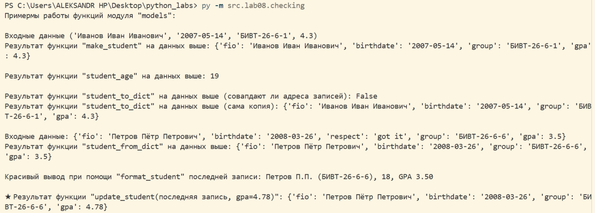
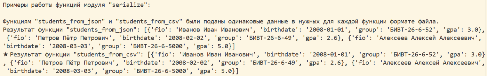
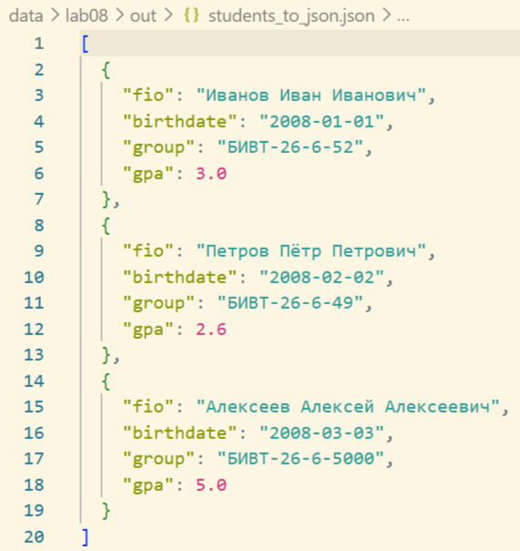
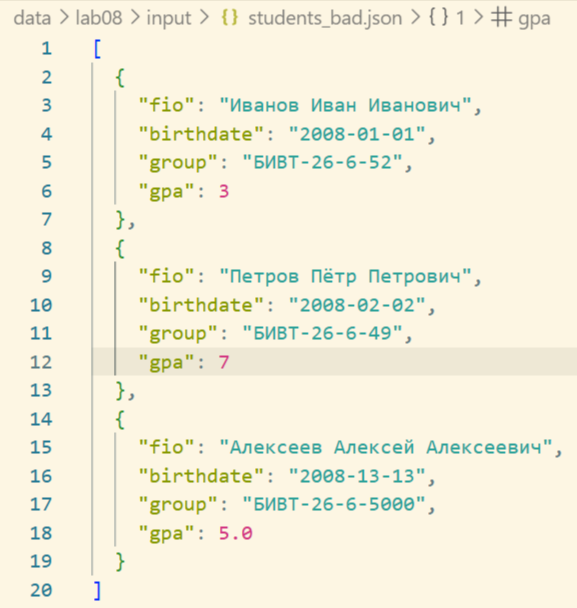
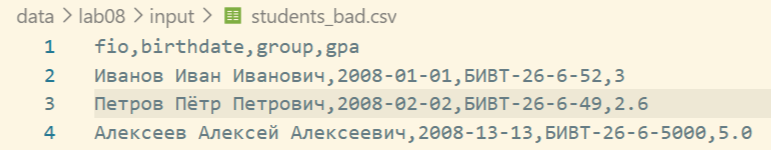
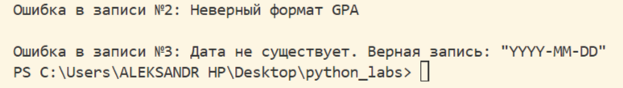

# Лабараторная работа №8
# Модель данных без классов: запись Student как словарь, валидация и сериализация

## Были реализованы два модуля с функциями, первый - для обработки и валидации записей, второй - для сериализации записей.

## 1ый модуль "models" (обработка и валидация):
- make_student - создание записи
```python
def make_student(fio: str, birthdate: str, group: str, gpa: int | float) -> dict:
    '''
    Создание записи после проверки корректности данных,
    при некорректности - ValueError.
    '''
    if type(birthdate) != str: raise ValueError('Неверный формат даты рождения')
    try:
        b = date.fromisoformat(birthdate)
    except ValueError:
        raise ValueError('Дата не существует. Верная запись: "YYYY-MM-DD"')
    if b > date.today(): raise ValueError('Дата из будущего')
    if type(fio) != str or fio.strip() == '': raise ValueError('Неверный формат ФИО')
    if type(group) != str or group.strip() == '': raise ValueError('Неверный формат группы')
    if ((type(gpa) != int) and (type(gpa) != float)) or not (0 <= gpa <= 5): raise ValueError('Неверный формат GPA')

    return {'fio': fio, 'birthdate': birthdate, 'group': group, 'gpa': float(gpa)}
```

- validate_student - валидация готовой записи в виде словаря
```python
def validate_student(rec: dict) -> None:
    '''
    Валидация записи о студенте.
    '''
    if type(rec) != dict: raise ValueError('Запись должна быть словарём')
    if set(rec) != set(("fio", "birthdate", "group", "gpa")): raise ValueError('Неверный набор параметров')
    if type(rec['birthdate']) != str: raise ValueError('Неверный формат даты рождения')
    try:
        b = date.fromisoformat(rec['birthdate'])
    except ValueError:
        raise ValueError('Дата не существует. Верная запись: "YYYY-MM-DD"')
    if b > date.today(): raise ValueError('Дата из будущего')
    if type(rec['fio']) != str or rec['fio'].strip() == '': raise ValueError('Неверный формат ФИО')
    if type(rec['group']) != str or rec['group'].strip() == '': raise ValueError('Неверный формат группы')
    if ((type(rec['gpa']) != int) and (type(rec['gpa']) != float)) or not (0 <= rec['gpa'] <= 5): raise ValueError('Неверный формат GPA')
```

- student_age - вычисление возраста студента из записи
```python
def student_age(rec: dict, today=None) -> int:
    '''
    Вычисление возраста студента, по умолчанию, на сегодня.
    При желании посчитать на другой день - задать явно через параметр today.
    '''
    validate_student(rec)
    b = date.fromisoformat(rec["birthdate"])
    if today != None:
        today_date = date.fromisoformat(today)
    else:
        today_date = date.today()
    if today_date < b: raise ValueError('Невозможно вычислить возраст на дату раньше даты рождения')
    if today_date.month < b.month: return today_date.year - b.year - 1
    if today_date.month == b.month and today_date.day < b.day: return today_date.year - b.year - 1
    return today_date.year - b.year
```

- student_to_dict - создание копии записи
```python
def student_to_dict(rec: dict) -> dict:
    '''
    Создание копии студента при успешной валидации.
    '''
    validate_student(rec)
    return dict(rec)
```

- student_from_dict - десериалиазация из словаря
```python
def student_from_dict(d: dict) -> dict:
    '''
    Десериализация данных из словаря только по нужным параметрам.
    '''
    for k in ['fio', 'birthdate', 'group', 'gpa']:
        if k not in d: raise ValueError(f'Параметр {k} отсутсвует')
    rec = make_student(d['fio'], d['birthdate'], d['group'], float(d['gpa']))
    validate_student(rec)
    return rec
```

- format_student - красивый вывод записи
```python
def format_student(rec: dict) -> str:
    '''
    Красивый вывод записи данных о студенте.
    '''
    validate_student(rec)
    initials = rec['fio'].strip().split()[0].capitalize() + ' ' + \
                ''.join([x[0].upper() + '.'  for x in rec['fio'].strip().split()[1:]]) 
    return f'{initials} ({rec['group']}), {student_age(rec)}, GPA {rec['gpa']:.2f}'
```

- (★) update_student - обновление явно заданных параметров и создание новой записи
```python
def update_student(rec: dict, **fields) -> dict:
    '''
    Создание новой записи студента с обновлёнными полями.
    '''
    new_rec = student_to_dict(rec)
    for k1 in fields.keys():
        if k1 not in ['fio', 'birthdate', 'group', 'gpa']: raise KeyError(f'"{k1}" не является параметром для создания записи студента')
    for k2, v in fields.items():
        try:
            new_rec[k2] = v
            validate_student(new_rec)
        except ValueError as e:
            raise ValueError(f'Ошибка в значении параметра "{k2}": {e}')
    return new_rec
```

## 2ой модуль "serialize" (сериализация):
- students_to_json - сериализация списка записей в json-файл
```python
def students_to_json(students: list[dict], path: str | Path) -> None:
    '''
    Запись списка студентов в .json файл.
    '''
    data = [student_to_dict(s) for s in students]
    final_path = Path(path)
    if final_path.suffix != '.json': raise ValueError('Файл для результата должен быть в формате ".json"')
    ensure_parent_dir(final_path)

    with open(final_path, 'w', encoding='utf-8') as f:
        json.dump(data, f, ensure_ascii=False, indent=2)
```

- students_from_json - сериализация json-файла в список записей
```python
def students_from_json(path: str | Path) -> list[dict]:
    '''
    Преобразование .json файла в список студентов.
    '''
    final_path = Path(path)
    if final_path.suffix != '.json': raise ValueError('Файл для обработки должен быть в формате ".json"')
    with open(final_path, 'r', encoding='utf-8') as f:
        students = json.load(f)

    checked_students = []
    for i, st in enumerate(students):
        try:
            checked_students.append(student_from_dict(st))
        except ValueError as e:
            raise ValueError(f'Ошибка в записи №{i + 1}: {e}')
    return checked_students
```

- (★) students_from_csv - сериализация csv-файла в список записей
```python
def students_from_csv(path: str | Path) -> list[dict]:
    '''
    Преобразование .csv файла в список студентов.
    '''
    final_path = Path(path)
    if final_path.suffix != '.csv': raise ValueError('Файл для обработки должен быть в формате ".csv"')
    with open(final_path, 'r', encoding='utf-8', newline='') as f:
        sample = f.read()
        sniffer = csv.Sniffer()
        dialect = sniffer.sniff(sample)
        f.seek(0)
        students = csv.DictReader(f, dialect=dialect)
        if not sniffer.has_header(sample): raise ValueError('В файле отсутсвует заголовок')
        if students.fieldnames != ['fio', 'birthdate', 'group', 'gpa']: raise ValueError('Заголовок не соответсвует требуемым параметрам: "fio", "birthdate", "group", "gpa"')
        new_students = list(students)

    checked_students = []
    for i, st in enumerate(new_students):
        try:
            checked_students.append(student_from_dict(st))
        except ValueError as e:
            raise ValueError(f'Ошибка в записи №{i + 1}: {e}')
    return checked_students
```

### Примеры работы (для удобства был написан код в "checking"):
### 1. Функции из "models"


### 2. Функции из "serialize"
### 1. students_from_json и students_from_csv

### 2. students_to_json


### 3. Ошибки на функциях из модуля serialize (в 1ом файле - ошибка в среднем балле, во 2ом - в дате):



```python
try:
    students_from_json('data/lab08/input/students_bad.json')
except ValueError as e:
    print(e)
print('')

try:
    students_from_csv('data/lab08/input/students_bad.csv')
except ValueError as e:
    print(e)
```



### Политика битых записей - строгая:
Если при ошибке прерывать программу, то раньше, проще и более явно появляется возможность изменить ошибку. А также при использовании политики "skip" - целостность не является важным фактором, что неправильно.