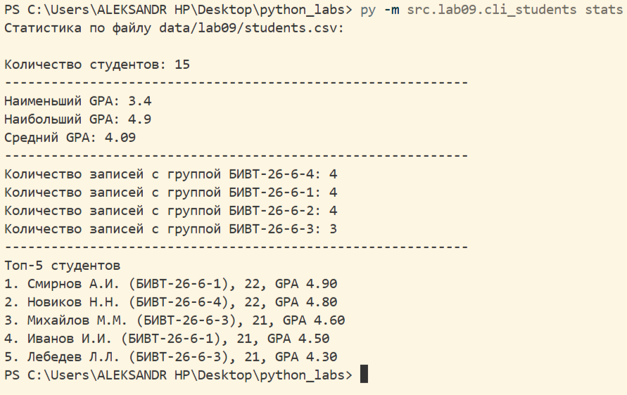
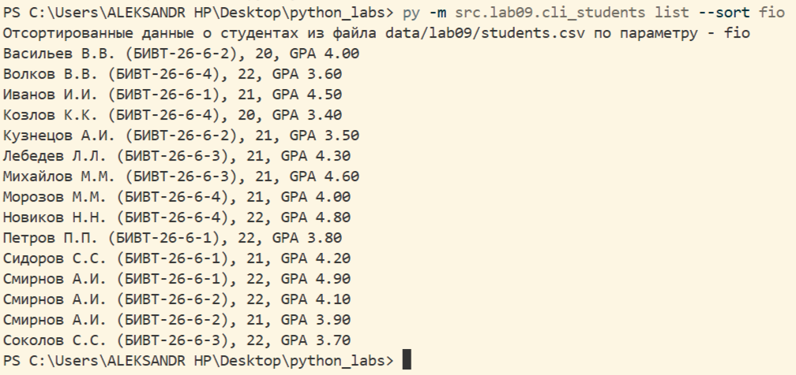
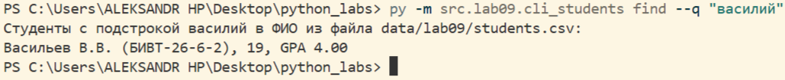
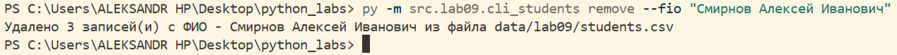
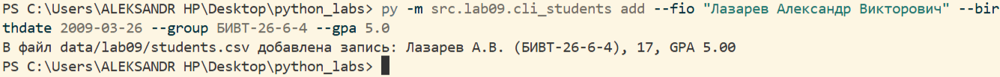
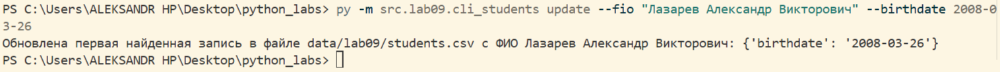

# Лабораторная работа №9
# «База данных» на CSV: CRUD-функции над students.csv и CLI

## Был реализован модуль group со служебными функциями хранилища и функции CRUD (create, read, update, delete). Также был реализован модуль cli_students для работы с базами данных через инициализацию функций из модуля group.

## Запуск cli_students:
```python
py -m src.lab09.cli_students [подкоманда] [аргументы]
```

## 1ый модуль - "group":
Что импортировалось:
```python
from pathlib import Path
from src.lab08.models import STUDENT_FIELDS, validate_student, update_student
from src.lab08.serialize import students_from_csv
from src.lab04.io_to_txt import ensure_parent_dir
import csv
```
### Служебные функции хранилища:
- ensure_storage - создание хранилища в формате .csv с заголовком "fio,birtdate,group,gpa"
```python
def ensure_storage(path: str | Path) -> None:
    '''
    Создание .csv файла с заголовком для хранения записей о студентах.
    '''
    p = Path(path)
    if p.suffix != '.csv': raise ValueError('Файл должен быть в .csv формате')
    if not p.exists():
        p.parent.mkdir(parents=True, exist_ok=True)
        p.write_text(','.join(STUDENT_FIELDS), encoding='utf-8')
```

- load_students - считывание массива студента из .csv файла с проверкой каждого
```python
def load_students(path: str | Path) -> list[dict]:
    '''
    Проверка каждой записи и создание массива с записями о студентах.
    '''
    ready_students = students_from_csv(Path(path))
    return ready_students
```

- save_students - запись студентов после проверки в .csv файл
```python
def save_students(path: str | Path, students: list[dict]) -> None:
    '''
    Создание .csv файла с записями из списка "students".
    '''
    if Path(path).suffix != '.csv': raise ValueError('Файл должен быть в .csv формате')
    ensure_parent_dir(path)
    with open(Path(path), 'w', newline='', encoding='utf-8') as f:
        csv_file = csv.DictWriter(f, fieldnames=STUDENT_FIELDS, extrasaction='ignore')
        csv_file.writeheader()
        for st in students:
            validate_student(st)
        csv_file.writerows(students)
```

### Функции CRUD:
- add_student - добавление записи в конец базы данных (★ если студент с таким ФИО уже есть в базе данных - ошибка)
```python
def add_student(path: str | Path, student: dict) -> None:
    '''
    Добавление студента в конец записи.
    '''
    validate_student(student)
    students_from_file = load_students(Path(path))
    for rec in students_from_file:
        if rec["fio"] == student["fio"]: raise ValueError('Студент с таким ФИО уже присутсвует в базе данных')
    students_from_file.append(student)
    save_students(path, students_from_file)
```

- list_students - сортировка (по запросу) и считывание в список студентов из файла .csv
```python
def list_students(path: str | Path, sort_by=None) -> list[dict]:
    '''
    Сортировка записей по параметру sort_by (sort_by ∈ {None, "fio", "gpa"}).
    '''
    if sort_by not in {None, "fio", "gpa"}: raise ValueError(f'"{sort_by}" не является параметром для сортировки')
    students_to_sort = load_students(Path(path))
    return sorted(students_to_sort, key=lambda x: x[sort_by])
```

- find_students - поиск записей с переданной подстрокой (без учёта регистра)
```python
def find_students(path: str | Path, substr: str) -> list[dict]:
    '''
    Поиск записей, в которые входит аргумент "substr" (без учёта регистра).
    '''
    students_to_find = load_students(Path(path))
    return [rec for rec in students_to_find if substr.lower() in rec['fio'].lower()]
```

- remove_student - очистка базы данных от записей с переданным ФИО + вывод количества удалённых записей
```python
def remove_student(path: str | Path, fio: str) -> int:
    '''
    Удаление записей со значением fio, совпадающим с заданным параметром.
    Вывод количества таких записей.
    '''
    students_to_check = load_students(Path(path))
    counter = 0
    for i, rec in enumerate(students_to_check):
        if rec["fio"] == fio:
            students_to_check.pop(i)
            counter += 1
    save_students(path, students_to_check)
    return counter
```

- update_student - обновление данных первой в файле записи с переданным ФИО, уведомление об успешном результате
```python
def update_student(path, fio, **fields):
    '''
    Обновление параметров первого студента с заданным "fio".
    '''
    students = load_students(Path(path))
    for i, rec in enumerate(students):
        if rec['fio'] == fio:
            updated_student = update_student(rec, fields)
            rec[i] = updated_student
            save_students(path, students)
            return True
    return False
```

- (★) stats - подсчёт статистики по базе данных (количествой записей, минимальный/максимальный/средний GPA, количество студентов в группах, топ-5 студентов по GPA)
```python
def stats(path: str | Path) -> dict:
    students_to_analyze = load_students(path)
    counter = len(students_to_analyze)
    min_gpa, max_gpa = min([rec['gpa'] for rec in students_to_analyze]), max([rec['gpa'] for rec in students_to_analyze])
    avg_gpa = sum([rec['gpa'] for rec in students_to_analyze]) / counter
    sorted_by_gpa_students = list_students(path, sort_by='gpa')[::-1]
    all_groups = set([rec['group'] for rec in students_to_analyze])
    return {
        "count": counter,
        "min_gpa": min_gpa,
        "max_gpa": max_gpa,
        "avg_gpa": avg_gpa,
        "groups": {gr: len([rec for rec in students_to_analyze if rec['group'] == gr]) for gr in all_groups},
        "top_5_students": sorted_by_gpa_students[:5]
        }
```

## 2ой модуль:
Что импортировалось:
```python
import argparse
from src.lab08.models import make_student, format_student
from src.lab09.group import add_student, list_students, find_students, remove_student, update_student, stats
```
Общий аргумент --db - доступ к хранилищу
1. add - добавление записи и уведомление об этом (аргументы: fio, birthdate, group, gpa)
2. list - вывод списком записей с сортировкой при надобности (аргументы: [sort])
3. find - вывод студентов, с переданной подстрокой в ФИО (аргументы: q)
4. remove - удаление всех записей с переданным ФИО и уведомление о количестве таких записей (аргументы: fio)
5. update - обновление первой найденной в базе данных записи с переданным ФИО (аргументы: fio, [birthadte, gpa, group])
6. stats - вывод статистики о базе данных (аргументы: нет)
- подкоманды с переменными:
```python
parent_parser = argparse.ArgumentParser(add_help=False)
parent_parser.add_argument("--db", default='data/lab09/students.csv', help='путь к csv-хранилищу ("по умолчанию data/lab09/students.csv")')
parser = argparse.ArgumentParser(description="Работа с базами данных")
sub = parser.add_subparsers(dest="command", required=True)

p1 = sub.add_parser("add", parents=[parent_parser], help='Добавление записи')
p1.add_argument("--fio", dest="fio", required=True, help='ФИО добавляемого студента')
p1.add_argument("--birthdate", dest="birthdate", required=True, help='Дата рождения добавляемого студента')
p1.add_argument("--group", dest="group", required=True, help='Группа добавляемого студента')
p1.add_argument("--gpa", type=float, dest="gpa", required=True, help='Средний балл добавляемого студента')

p2 = sub.add_parser("list", parents=[parent_parser], help='Сортировка (при нужде) и вывод списком данных из файла')
p2.add_argument("--sort", dest='sort', default=None, help='Аргумент для сортировки, если она требуется')

p3 = sub.add_parser("find", parents=[parent_parser], help='Поиск студентов с переданной подстрокой в ФИО (без учёта регистра)')
p3.add_argument("--q", dest='string', required=True, help='Подстрока для поиска в ФИО')

p4 = sub.add_parser("remove", parents=[parent_parser], help='Удаление записей с переданным ФИО и вывод их количества')
p4.add_argument("--fio", dest='fio', required=True, help='ФИО по которому удалятся записей')

p5 = sub.add_parser("update", parents=[parent_parser], help='Обновление первой записи с переданным ФИО')
p5.add_argument("--fio", dest='fio', required=True, help='ФИО для поиска')
p5.add_argument("--gpa", type=float, dest='gpa', default=None, help='Обновлённый средний балл')
p5.add_argument("--group", dest='group', default=None, help='Обновлённая группа')
p5.add_argument("--birthdate", dest='birthdate', default=None, help='Обновлённая дата рождения')

p6 = sub.add_parser("stats", parents=[parent_parser], help='Вывод статистики по файлу с базой данных о студентах')
```
### Данные из students.csv файла до тестов:
```python
fio,birthdate,group,gpa
Иванов Иван Иванович,2005-03-15,БИВТ-26-6-1,4.5
Михайлов Михаил Михайлович,2005-06-14,БИВТ-26-6-3,4.6
Петров Петр Петрович,2004-07-22,БИВТ-26-6-1,3.8
Козлов Константин Константинович,2006-01-07,БИВТ-26-6-4,3.4
Сидоров Сидор Сидорович,2005-11-08,БИВТ-26-6-1,4.2
Соколов Сергей Сергеевич,2004-04-09,БИВТ-26-6-3,3.7
Смирнов Алексей Иванович,2004-01-30,БИВТ-26-6-1,4.9
Лебедев Леонид Леонидович,2005-10-21,БИВТ-26-6-3,4.3
Кузнецов Алексей Иванович,2005-05-12,БИВТ-26-6-2,3.5
Новиков Никита Николаевич,2004-08-16,БИВТ-26-6-4,4.8
Смирнов Алексей Иванович,2004-09-03,БИВТ-26-6-2,4.1
Морозов Максим Максимович,2005-02-28,БИВТ-26-6-4,4.0
Васильев Василий Васильевич,2006-02-18,БИВТ-26-6-2,4.0
Волков Владимир Владимирович,2004-11-11,БИВТ-26-6-4,3.6
Смирнов Алексей Иванович,2004-12-25,БИВТ-26-6-2,3.9
```

### Примеры работы:

- py -m src.lab09.cli_students stats


- py -m src.lab09.cli_students list --sort fio


- py -m src.lab09.cli_students find --q "василий"


- py -m src.lab09.cli_students remove --fio "Смирнов Алексей Иванович"


students.csv после применения remove:
```python
fio,birthdate,group,gpa
Иванов Иван Иванович,2005-03-15,БИВТ-26-6-1,4.5
Михайлов Михаил Михайлович,2005-06-14,БИВТ-26-6-3,4.6
Петров Петр Петрович,2004-07-22,БИВТ-26-6-1,3.8
Козлов Константин Константинович,2006-01-07,БИВТ-26-6-4,3.4
Сидоров Сидор Сидорович,2005-11-08,БИВТ-26-6-1,4.2
Соколов Сергей Сергеевич,2004-04-09,БИВТ-26-6-3,3.7
Лебедев Леонид Леонидович,2005-10-21,БИВТ-26-6-3,4.3
Кузнецов Алексей Иванович,2005-05-12,БИВТ-26-6-2,3.5
Новиков Никита Николаевич,2004-08-16,БИВТ-26-6-4,4.8
Морозов Максим Максимович,2005-02-28,БИВТ-26-6-4,4.0
Васильев Василий Васильевич,2006-02-18,БИВТ-26-6-2,4.0
Волков Владимир Владимирович,2004-11-11,БИВТ-26-6-4,3.6
```

- py -m src.lab09.cli_students add --fio "Лазарев Александр Викторович" --birthdate 2009-03-26 --group БИВТ-26-6-4 --gpa 5.0


students.csv после применения add:
```python
fio,birthdate,group,gpa
Иванов Иван Иванович,2005-03-15,БИВТ-26-6-1,4.5
Михайлов Михаил Михайлович,2005-06-14,БИВТ-26-6-3,4.6
Петров Петр Петрович,2004-07-22,БИВТ-26-6-1,3.8
Козлов Константин Константинович,2006-01-07,БИВТ-26-6-4,3.4
Сидоров Сидор Сидорович,2005-11-08,БИВТ-26-6-1,4.2
Соколов Сергей Сергеевич,2004-04-09,БИВТ-26-6-3,3.7
Лебедев Леонид Леонидович,2005-10-21,БИВТ-26-6-3,4.3
Кузнецов Алексей Иванович,2005-05-12,БИВТ-26-6-2,3.5
Новиков Никита Николаевич,2004-08-16,БИВТ-26-6-4,4.8
Морозов Максим Максимович,2005-02-28,БИВТ-26-6-4,4.0
Васильев Василий Васильевич,2006-02-18,БИВТ-26-6-2,4.0
Волков Владимир Владимирович,2004-11-11,БИВТ-26-6-4,3.6
Лазарев Александр Викторович,2009-03-26,БИВТ-26-6-4,5.0
```

- py -m src.lab09.cli_students update --fio "Лазарев Александр Викторович" --birthdate 2008-03-26


students.csv после применения update:
```python
fio,birthdate,group,gpa
Иванов Иван Иванович,2005-03-15,БИВТ-26-6-1,4.5
Михайлов Михаил Михайлович,2005-06-14,БИВТ-26-6-3,4.6
Петров Петр Петрович,2004-07-22,БИВТ-26-6-1,3.8
Козлов Константин Константинович,2006-01-07,БИВТ-26-6-4,3.4
Сидоров Сидор Сидорович,2005-11-08,БИВТ-26-6-1,4.2
Соколов Сергей Сергеевич,2004-04-09,БИВТ-26-6-3,3.7
Лебедев Леонид Леонидович,2005-10-21,БИВТ-26-6-3,4.3
Кузнецов Алексей Иванович,2005-05-12,БИВТ-26-6-2,3.5
Новиков Никита Николаевич,2004-08-16,БИВТ-26-6-4,4.8
Морозов Максим Максимович,2005-02-28,БИВТ-26-6-4,4.0
Васильев Василий Васильевич,2006-02-18,БИВТ-26-6-2,4.0
Волков Владимир Владимирович,2004-11-11,БИВТ-26-6-4,3.6
Лазарев Александр Викторович,2008-03-26,БИВТ-26-6-4,5.0
```